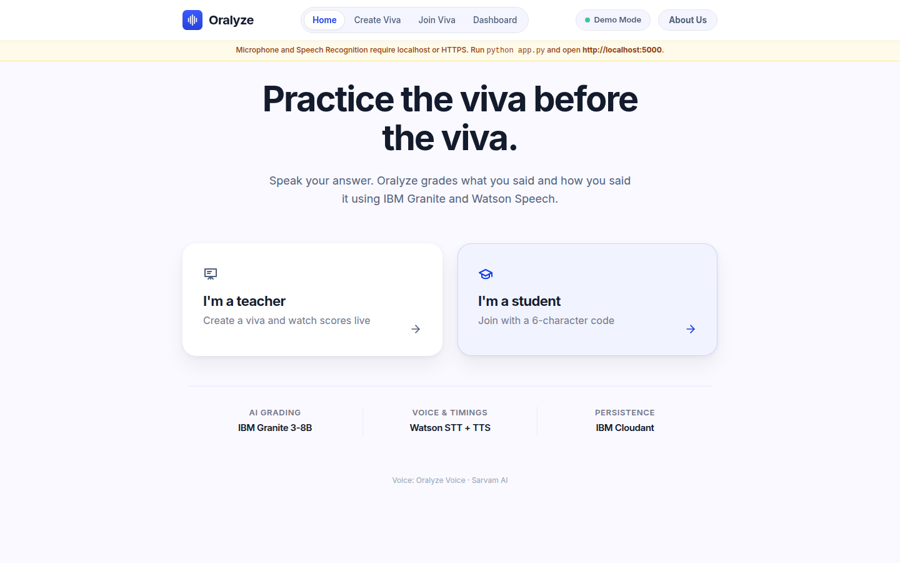
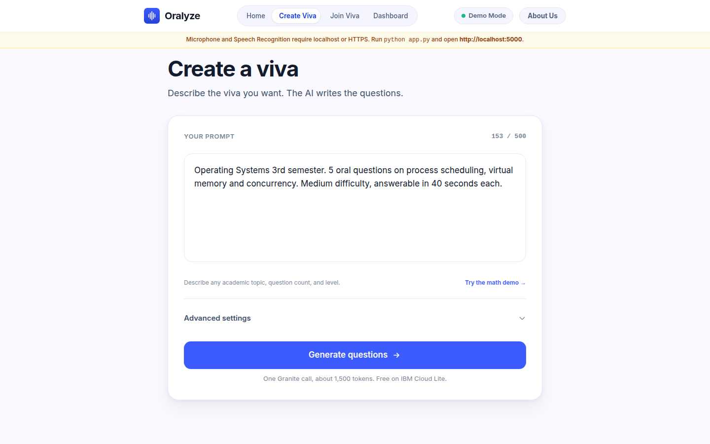
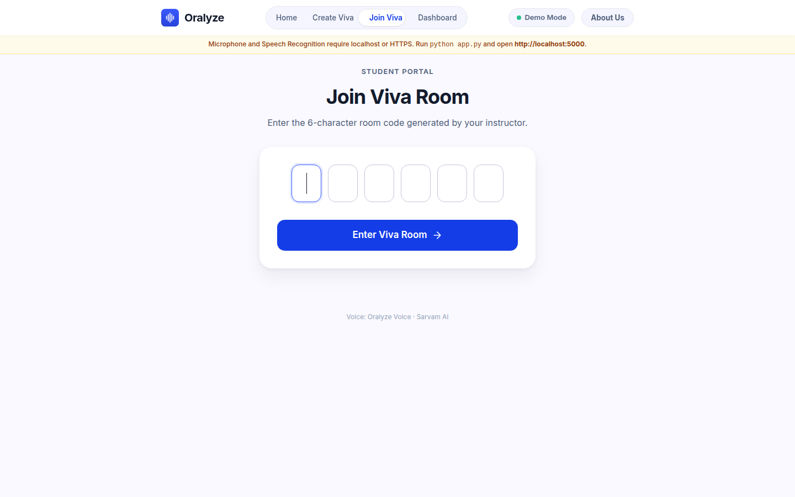
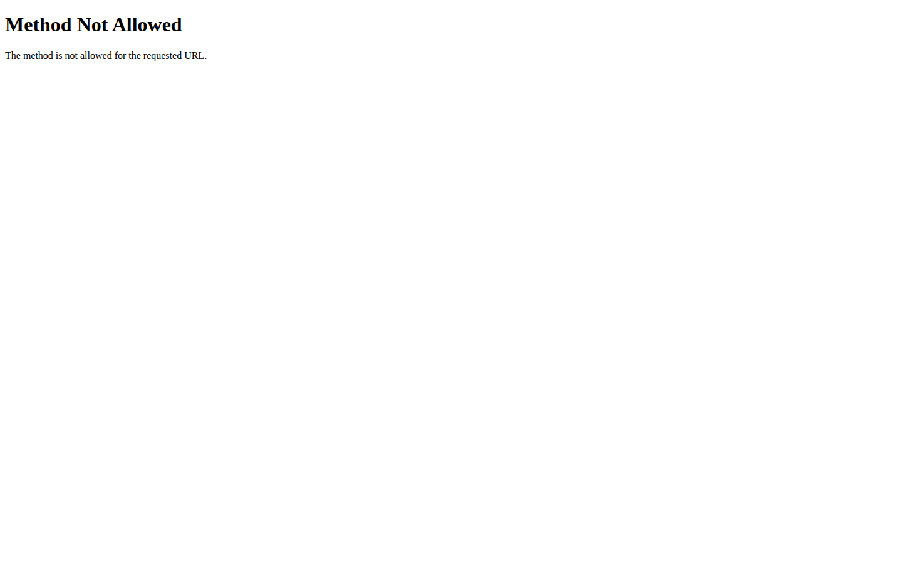
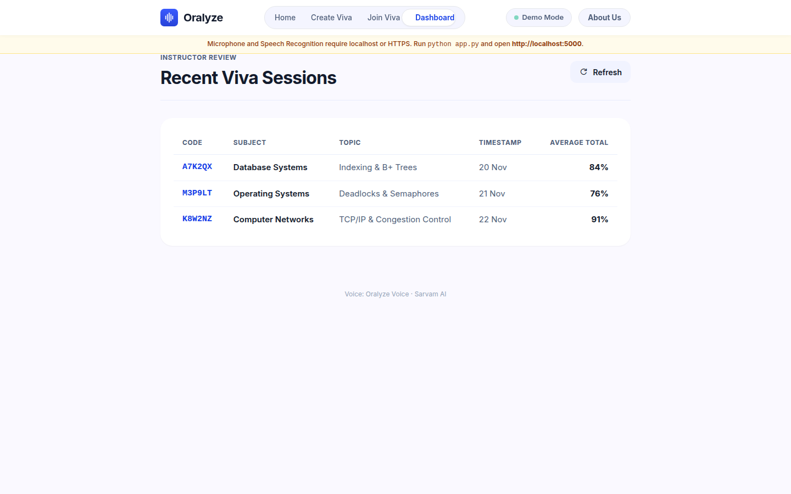
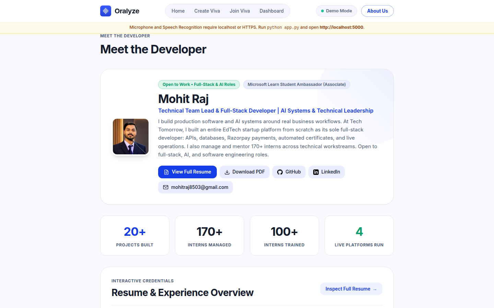
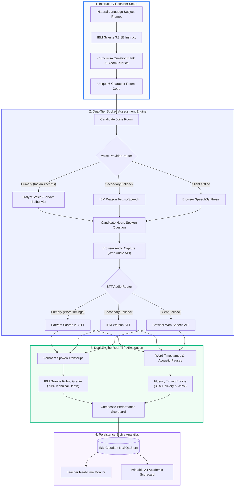
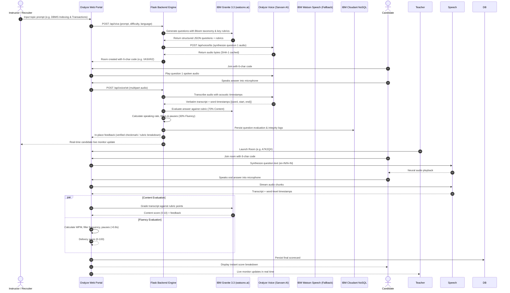

<div align="center">

  <br />
  
  <br />

  <h3>Autonomous AI Voice Viva Voce Examiner & Acoustic Fluency Evaluator</h3>

  <p align="center">
    <strong>Natural Language Viva Generation • Neural Speech Audio • Real-Time STT Word Timestamps • Rubric Grading</strong>
  </p>

  <p align="center">
    <em>Built for modern engineering colleges, automated academic oral examinations, and live student evaluations. Powered by IBM Cloud Lite infrastructure.</em>
  </p>

  <p align="center">
    <a href="https://mohitraj8503.github.io/Oralyze/"></a>
    <a href="https://github.com/mohitraj8503/Oralyze/stargazers"></a>
    <a href="https://github.com/mohitraj8503/Oralyze/blob/main/LICENSE"></a>
  </p>

  <p align="center">
    
    
    
    
    
    
    
    
  </p>

  <p align="center">
    <a href="#quick-overview">Quick Overview</a> •
    <a href="#platform-walkthrough">Platform Walkthrough</a> •
    <a href="#system-architecture">Architecture & Flow</a> •
    <a href="#scoring-methodology">Scoring Algorithm</a> •
    <a href="#getting-started">Getting Started</a> •
    <a href="#free-tier-limits">Lite Quotas</a> •
    <a href="#tech-stack">Tech Stack</a>
  </p>

</div>

---

## Quick Overview

Most college evaluation projects are standard CRUD apps (forms, attendance, dashboards). **Oralyze** replaces manual, subjective viva voce exams with an **autonomous, voice-interactive AI examiner**:

- **Instructor defines topic in free text**: *"DBMS 3rd semester, 5 questions on B+ tree indexing and transactions, 40s duration"*.
- **IBM Granite 3.3 8B Instruct** synthesizes structured viva questions with Bloom-taxonomy levels and evaluation key points.
- **Watson Text to Speech** speaks questions naturally to the student.
- **Microphone captures oral answer**: Real-time acoustic frequency analysis and live speech-to-text transcript streaming.
- **Dual scoring in seconds**: Content technical accuracy (70%) + delivery fluency metrics (30% based on speech rate, hesitation pauses >0.8s, and filler word ratios).
- **Zero-barrier hosting**: Runs as a 100% client-side offline demo on GitHub Pages or connected to IBM Cloud Lite services.

---

## Platform Walkthrough

<table align="center" width="100%">
  <tr>
    <td width="50%" align="center">
      <a href="docs/screenshots/01-landing-home.png"></a>
      <p><strong>1. Landing & Assessment Portal</strong><br /><em>Host or student navigation with active mode selection and Oralyze Voice attribution.</em></p>
    </td>
    <td width="50%" align="center">
      <a href="docs/screenshots/02-teacher-setup.png"></a>
      <p><strong>2. Instructor Prompt & Question Generation</strong><br /><em>Free-text curriculum prompt; IBM Granite 3.3 outputs structured questions with Bloom rubrics.</em></p>
    </td>
  </tr>
  <tr>
    <td width="50%" align="center">
      <a href="docs/screenshots/03-student-join.png"></a>
      <p><strong>3. Candidate Join Room</strong><br /><em>6-box room code input with auto-paste distribution and instant audio check.</em></p>
    </td>
    <td width="50%" align="center">
      <a href="docs/screenshots/04-live-examination.png"></a>
      <p><strong>4. Live Voice Viva & Real-Time Transcript</strong><br /><em>Sarvam Bulbul speaks question; Saaras STT captures spoken answer with acoustic word timestamps.</em></p>
    </td>
  </tr>
  <tr>
    <td width="50%" align="center">
      <a href="docs/screenshots/05-dashboard.png"></a>
      <p><strong>5. Classroom Analytics & Session Log</strong><br /><em>Instructor dashboard with aggregated session performance and Cloudant records.</em></p>
    </td>
    <td width="50%" align="center">
      <a href="docs/screenshots/06-about-developer.png"></a>
      <p><strong>6. Meet the Developer & Verified Credentials</strong><br /><em>Interactive resume viewer, live website links, technology competencies, and direct contact.</em></p>
    </td>
  </tr>
</table>

---

## System Architecture



### Complete Sequence Dataflow



---

## Scoring Methodology

Oralyze grades answers through a **composite metric (0-100%)** combining technical understanding with verbal communication skills:

$$\text{Final Score} = (\text{Content Score} \times 10 \times 0.70) + (\text{Delivery Score} \times 0.30)$$

### 1. Technical Content Evaluation (70% Weight)
* Evaluated by **IBM Granite 3.3 8B Instruct** against key concepts from the rubric.
* Rewards correct conceptual explanations, technical terminology, and reasoning.
* Detects missing components, providing actionable, constructive feedback.

### 2. Oral Delivery & Fluency Engine (30% Weight)
* **Speaking Pace (WPM)**: Calibrated to an optimal academic speaking band of **110–165 WPM**.
* **Hesitation Pauses**: Detects silent intervals $>0.8\text{s}$ between word timestamps using Watson STT acoustics.
* **Filler Word Density**: Analyzes frequency of common discourse markers (`um`, `uh`, `like`, `actually`, `basically`).

---

## Getting Started

### 1. Hosted Zero-Config Demo (GitHub Pages)
Test the entire viva workflow directly in your browser with zero API keys or backend setup:  
👉 **[https://mohitraj8503.github.io/Oralyze/](https://mohitraj8503.github.io/Oralyze/)**

* Uses client-side Web Speech API for voice listening and speaking.
* Keyword overlap grader running in WebAssembly/JS.
* Offline question bank bundled with zero external dependencies.

---

### 2. Local Setup with Live IBM Backend

#### Prerequisites
* Python 3.12+
* An IBM Cloud account (Free Lite tier)

#### Installation
```bash
# Clone the repository
git clone https://github.com/mohitraj8503/Oralyze.git
cd Oralyze

# Install minimal pip packages (Flask, requests, python-dotenv, pytest)
pip install -r requirements.txt

# Create environment configuration
cp .env.example .env
```

#### Configure `.env`
```bash
IBM_API_KEY=your_ibm_cloud_api_key
WATSONX_PROJECT_ID=your_watsonx_project_id
TTS_URL=https://api.us-south.text-to-speech.watson.cloud.ibm.com/instances/...
STT_URL=https://api.us-south.speech-to-text.watson.cloud.ibm.com/instances/...
CLOUDANT_URL=https://...-bluemix.cloudantnosqldb.appdomain.cloud
MOCK_MODE=0
```

#### Run the Server
```bash
python app.py
```
Open **`http://localhost:5000`** in Google Chrome or modern Chromium browser.

---

## Environment Variables

| Variable | Description | Source | Required |
| :--- | :--- | :--- | :--- |
| `IBM_API_KEY` | Unified IBM Cloud IAM API Key | IBM Cloud Manage $\to$ Access (IAM) $\to$ API keys | Yes (for live mode) |
| `WATSONX_PROJECT_ID` | watsonx.ai Project GUID | watsonx project Manage $\to$ General tab | Yes (for live mode) |
| `TTS_URL` | Watson Text to Speech service URL | Watson TTS resource details page | Optional (falls back to mock audio) |
| `STT_URL` | Watson Speech to Text service URL | Watson STT resource details page | Optional (falls back to browser Web Speech) |
| `CLOUDANT_URL` | IBM Cloudant service URL | Cloudant resource Service credentials | Optional (falls back to local JSON store) |
| `MOCK_MODE` | Set to 1 for zero-network offline mode | Local environment flag | No (default: 1 if keys missing) |

---

## Free Tier Limits & Production Specifications

| Service | Lite Tier Monthly Quota | Fallback Behavior on Depletion |
| :--- | :--- | :--- |
| **IBM Granite 3.3 (watsonx.ai)** | 300,000 tokens / month | Multi-provider fallback (OpenRouter -> Groq -> Gemini -> local question bank) |
| **Watson Speech to Text** | 500 audio minutes / month | Falls back to browser Web Speech recognition |
| **Watson Text to Speech** | 10,000 characters / month | Falls back to browser Web Speech API synthesis |
| **IBM Cloudant** | 1 GB storage, 10 writes/sec | Falls back to local JSON session storage |

> For complete specifications, consult [docs/limits.md](docs/limits.md), [docs/PRODUCTION.md](docs/PRODUCTION.md), and the [Production Audit Report](AUDIT.md) / [Post-Fix Verification](AUDIT-AFTER.md).

---

## Project Structure

```text
Oralyze/
├── app.py                      # Flask REST backend and room coordinator
├── config.py                   # Environment configuration & credential validation
├── CHANGELOG.md                # Conventional Commits changelog
├── CONTRIBUTING.md             # Contribution guidelines
├── LICENSE                     # MIT Open Source License
├── AUDIT.md                    # Pre-fix production audit report
├── AUDIT-AFTER.md              # Post-fix audit verification report
├── data/
│   └── questions.json          # Bundled question bank across 7 curriculum subjects
├── docs/
│   ├── limits.md               # Documented platform quotas & scope limits
│   ├── PRODUCTION.md           # Measured benchmarks and system architecture
│   ├── screenshots/            # 1440x900 desktop walkthrough screenshots
│   └── social-preview.png      # Repository social preview card
├── services/
│   ├── fluency.py              # Speaking rate, pause, and filler analytics
│   ├── granite.py              # Granite prompt generation and rubric grading
│   ├── ibm_auth.py             # IAM token exchange and cache management
│   ├── speech.py               # Raw REST Watson STT and TTS integrations
│   ├── store.py                # Cloudant NoSQL and local JSON persistence
│   └── llm/                    # Multi-provider LLM fallback dispatcher
├── static/
│   ├── 404.html                # GitHub Pages SPA hash redirector
│   ├── config.js               # Client runtime configuration (API_BASE)
│   ├── favicon.ico             # Multi-layer 16/32/48 Windows icon
│   ├── index.html              # Unified responsive single-page application
│   ├── manifest.webmanifest    # PWA progressive web app manifest
│   ├── assets/icons/           # 16, 32, 180, 192, 512 PNG app icons
│   ├── brand/                  # Application brand identity assets
│   ├── data/                   # Client offline dataset copy
│   └── js/
│       ├── api.js              # Unified data abstraction layer
│       └── grader.js           # Browser keyword-overlap grading engine
└── tests/
    ├── test_fluency.py         # Unit tests for fluency metrics
    └── test_pipeline.py        # Integration tests for prompt, fallback, cache & health
```

---

## Voice Layer & Provider Policy

Oralyze integrates **Oralyze Voice** — a unified multi-tiered voice and speech architecture:

- **Primary Voice Layer (Oralyze Voice)**: Powered by **Sarvam AI** (`bulbul:v3` neural TTS, `saaras:v3` acoustic STT with word-level timestamps, `mayura:v1` translation, and `text-lid`). Delivers high-fidelity Indian-accent English, Hindi, and Hinglish understanding with low latency and economical resource usage.
- **Reasoning Engine**: **IBM Granite 3.3 8B Instruct** (`ibm/granite-3-3-8b-instruct` on watsonx.ai). Drives question generation, Bloom's taxonomy structuring, and deep rubric evaluation.
- **Enterprise Speech Fallback**: **IBM Watson Text to Speech & Speech to Text** via raw REST endpoints.
- **Resilient Fallback Ladder**:
  $$\text{Oralyze Voice (Sarvam AI)} \longrightarrow \text{IBM Watson Speech} \longrightarrow \text{Browser Web Speech API} \longrightarrow \text{Typed Input}$$
  A viva session is **always completable** even if every external cloud voice provider is offline or quota-exhausted.

---

## Tech Stack

- **Backend**: Python 3.12, Flask, raw REST with `requests` (no heavyweight SDKs)
- **Generative AI & Reasoning**: IBM watsonx.ai (Granite 3.3 8B Instruct)
- **Primary Voice AI**: Sarvam AI (Bulbul v3 TTS, Saaras v3 STT, Mayura v1 Translation, Text-LID)
- **Secondary Speech AI**: IBM Watson Text to Speech, IBM Watson Speech to Text, Web Speech API
- **Database**: IBM Cloudant NoSQL DB (Apache CouchDB based)
- **Frontend**: Vanilla ES6+ JavaScript, Tailwind CSS, Web Audio API AnalyserNode

---

## Contributing & Team

Developed by **Catalytic Coders** (Mohit Raj & teammates) for college minor project submission on IBM Cloud Lite.

Contributions and issues are welcome! Feel free to open a pull request or submit an issue.

---

## License

This project is open-source and available under the [MIT License](LICENSE).
